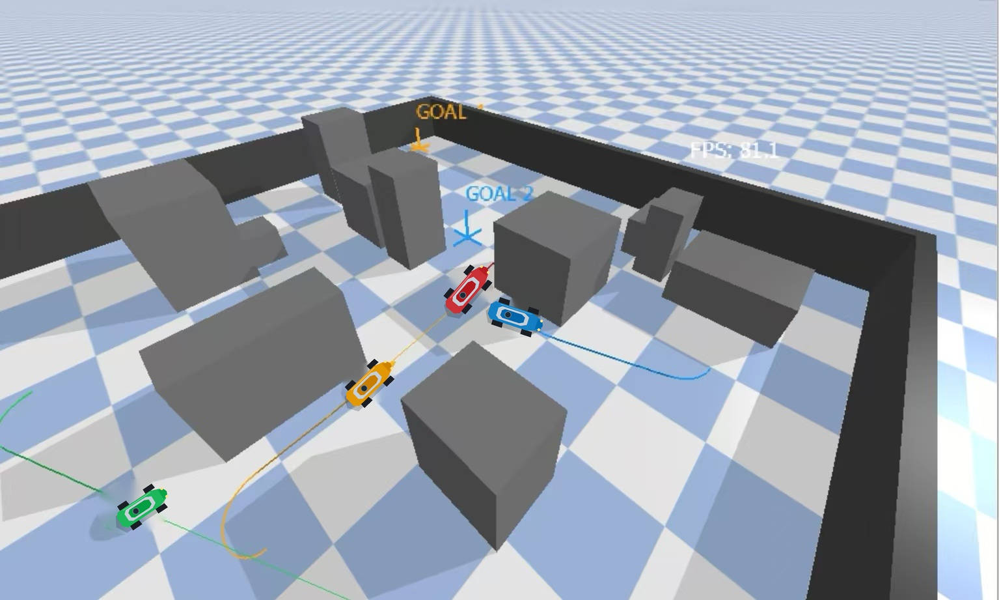

# AIRC-ROS2-Istruction

面向课堂教学的移动机器人导航与 PPO 强化学习 Demo。学生可以观察小车如何感知障碍、选择速度、获得奖励，再亲自训练策略，用训练曲线与固定场景评估判断效果。



环境用 MuJoCo 表示地图、查询 LiDAR 射线，采用 Gymnasium 的 `reset/step` 接口。小车按二维差速运动学更新位姿，碰撞由圆形 footprint 与墙体、箱形障碍进行几何检查。目前没有模拟车轮动力学、惯性、打滑、传感器噪声或 ROS2 通信，适合作为导航强化学习教学起点。

## 1. 安装与运行位置

```bash
git clone https://github.com/WSH-WX/AIRC-ROS2-Istruction.git
cd AIRC-ROS2-Istruction

# 按设备选择一种 PyTorch 安装方式。CPU：
python3 -m pip install torch --index-url https://download.pytorch.org/whl/cpu
# NVIDIA GPU 可改装匹配本机驱动的 CUDA 版本，例如：
# python3 -m pip install torch --index-url https://download.pytorch.org/whl/cu121

python3 -m pip install -r requirements.txt
```

下文命令均在项目根目录执行。当前远程主机的目录是：

```bash
ssh gwh-3090
cd /home/pc/AIRC-ROS2-Istruction
```

场景和射线计算在 CPU 上运行，策略网络可用 CPU 或 CUDA。可视化需要主机桌面图形会话；`--headless` 评估和 PNG 绘图不需要窗口。普通 SSH 不一定有图形会话，需要配置匹配主机桌面的 `DISPLAY`、`XAUTHORITY`，建议先在主机桌面终端演示窗口。

## 2. 发布的预训练策略

预训练示例统一加载 **`pre_train/policy.pt`**，无需发布整个 `runs/`：

```text
pre_train/
├── policy.pt           # 完整 checkpoint：policy、opt、step
├── train_config.json   # 原训练参数快照，包含模型类型和策略参数
├── env_config.json     # 匹配权重的观测、动作、场景与奖励定义
├── model_config.json   # 匹配权重的网络结构
└── provenance.json     # 来源、步数与 SHA-256 校验值
```

权重来自本地主机原 run 的 `step-260046848.pt`，记录步数为 **260,046,848**。只是复制并改名，权重内容未变；虽然叫 `policy.pt`，它仍是完整 checkpoint，不是裸 `state_dict`。请将上面五个文件一起发布。评估器读取权重同目录的三份配置，因此不依赖未上传的 `runs/`，也不会因修改当前 `config/` 而悄悄改变预训练评估。

**原训练配置是 4096 个环境、每环境 256 步；当前课堂训练配置是 8 个环境、每环境 256 步。** `pre_train/train_config.json` 保留原始配置供加载与溯源，不要直接拿它恢复课堂训练；课堂实验编辑 `config/train_config.json` 并创建新 run。

## 3. 环境演示、可视化测试与轨迹图

### 3.1 不加载权重的场景演示

```bash
# 简单目标方向控制器，不是强化学习策略。
python3 -m tools.mujoco_demo --controller goal --seed 0 --episodes 5

# 随机动作，便于观察环境响应和碰撞。
python3 -m tools.mujoco_demo --controller random --seed 0 --episodes 2
```

### 3.2 加载 policy.pt 可视化测试

```bash
python3 -u -m tools.mujoco_policy_test \
  --ckpt pre_train/policy.pt \
  --seed 10000 --episodes 6 --fps 10
```

这是**冻结权重的确定性评估**：调用 `policy.eval()`、`act_deterministic()`、`torch.inference_mode()`，关闭梯度，不创建优化器，不更新模型。默认一次运行一个 CPU 环境。关闭窗口或按 Ctrl+C 退出。

| 参数 | 解释 |
| --- | --- |
| `--ckpt` | 权重路径，发布示例统一用 `pre_train/policy.pt` |
| `--seed 10000` | 首回合种子，第 i 个回合使用 `10000+i`（i 从 0 开始） |
| `--episodes 6` | 总评估回合数 |
| `--fps 10` | 最多每秒显示 10 个控制步；`dt=0.1` 时约为仿真实时速度，计算慢时可能更慢 |
| `--fps 0` | 取消显示限速 |
| `--device cpu` | 推理设备，可改为可用的 `cuda:0` |
| `--headless` | 不开窗口，不做显示限速，快速评估 |

### 3.3 绘制六宫格评估轨迹图

```bash
python3 -u -m tools.mujoco_policy_test \
  --ckpt pre_train/policy.pt \
  --headless \
  --episodes 64 --seed 10000 \
  --plot-episodes 6 \
  --output eval_outputs/pre_train
```

评估种子 10000～10063 的 64 个回合，绘制前 6 个回合；`--plot-episodes` 只控制绘图数量，不改变评估总数。输出：

```text
eval_outputs/pre_train/
├── trajectories.png    # 六宫格：灰色障碍、绿色起点、红色目标与蓝色轨迹
└── results.json        # 汇总、逐回合指标和所绘回合的地图/轨迹坐标
```

图顶端统计全部回合的成功/碰撞/超时数量，每个子图标明种子、结果和步数。红圈是目标判定半径。终端打印各回合奖励、仿真时间和汇总。重复使用同一输出目录会覆盖这两个文件；不加 `--output` 就只打印结果。

每次换权重都应重新测量，不能沿用另一个 checkpoint 的评估成绩。对比学生模型时固定同一组种子与环境；再使用新种子检查泛化。确定性动作不等于任意场景都能成功。

当前发布权重（260,046,848 步）按上述命令、CPU、种子 10000～10063 实测：成功 **63/64（98.4375%）**、碰撞 **1/64**、超时 **0/64**，平均回合奖励约 **11.86345**，成功回合平均仿真耗时约 **12.90476 s**。碰撞回合种子为 **10044**。这可作为课堂误差分析案例；旧 `step-258998272.pt` 的 64/64 成绩不属于当前权重。

## 4. 小车状态、观测和动作

### 4.1 仿真状态与任务

每次 `reset` 随机生成障碍、起点、朝向与目标，固定种子可复现场景。

| 状态/场景量 | 含义和默认值 |
| --- | --- |
| `env.pos=(x,y)` | 世界坐标位置，m |
| `env.yaw` | 航向角，rad |
| `env.goal` | 世界坐标目标点 |
| `env.prev_cmd`, `env.prev_prev_cmd` | 前两次速度指令，用于历史观测和平滑惩罚 |
| `env.steps` | 当前回合控制步数 |
| 场地 | 12 m × 12 m，墙厚 0.25 m |
| 障碍 | 10 个轴对齐箱体，平面边长分别在 0.35～1.0 m 采样 |
| 碰撞轮廓 | 半径 0.22 m 的圆形 footprint |
| 控制周期 | `dt=0.1 s`，即 10 Hz |
| 到达条件 | 距离目标 ≤ 0.3 m |
| 最大回合 | 600 步，即最多 60 s 仿真时间 |

策略不直接读取世界坐标地图、绝对位置或目标绝对坐标，只接收局部观测。

### 4.2 112 维策略观测

```text
[105 个归一化 LiDAR 距离,
 sin(目标相对方向), cos(目标相对方向),
 前一时刻归一化线速度, 前一时刻归一化角速度,
 归一化线速度变化, 归一化角速度变化,
 归一化目标距离]
```

| 分量 | 计算方式 |
| --- | --- |
| LiDAR | `R=max(8, ceil(2π×patch_meters/ray_max_gap))`，默认量程 10 m、间距参数 0.6，得到 105 条射线；从车头方向绕车一周，距离除以量程，限制到 `[0,1]` |
| 目标方向 | `atan2(goal_y-y,goal_x-x)-yaw` 的正弦与余弦，避免角度跳变 |
| 历史速度 | 默认前进模式下 `vx_norm=(vx-0.3)/0.3`，`omega_norm=omega/1.5` |
| 速度变化 | `(vx_prev-vx_prevprev)/0.6`、`(omega_prev-omega_prevprev)/3.0` |
| 目标距离 | `min(distance/10,1)` |

`env_config.json` 中保留的 `safe_distance`、`task_point_max_dist_m` 当前未被 MuJoCo 环境读取，不代表已生效的安全距离或目标采样范围。

### 4.3 两维动作与状态更新

动作是 `(vx,omega)`，默认 `vx∈[0,0.6] m/s`、`omega∈[-1.5,1.5] rad/s`。`vx_forward_only=true` 表示不能倒车。策略使用 tanh 高斯分布映射到动作边界；训练时采样，确定性评估使用均值经 tanh 映射后的动作。

```text
yaw_next = wrap(yaw + omega × dt)
pos_next = pos + vx × dt × [cos(yaw_next), sin(yaw_next)]
```

先更新朝向再移动；候选位置碰撞时不接受新的位置和朝向，并结束回合。到达或碰撞对应 `terminated=True`，达到步数上限对应 `truncated=True`。批量训练适配器自动重置结束的环境。条件同时出现时，结果按成功、碰撞、超时顺序互斥归类。

小车由车身、四轮、传感器和车灯组成显示模型，禁用接触且不参与 LiDAR。仅替换外观，保持观测、动作、奖励和碰撞轮廓一致时无需重训；改变射线数、网络结构、动作边界或物理行为后需要重新验证，通常需要重训。

## 5. 奖励与惩罚：实际代码公式

`d_old`、`d_new` 是本步移动前后与目标的距离，`I` 是条件成立时为 1 的指示量。默认参数来自 `env_config.json`：

| 项 | 默认计算 | 教学解释 |
| --- | --- | --- |
| 距离进度 | `+0.1×(d_old-d_new)/(vx_max×dt)` | 靠近为正、远离为负；默认分母为 0.06 m |
| 碰撞惩罚 | `-2.0×I_collision×abs(vx)/vx_max` | 与本步指令速度成比例，并非固定扣 2 分 |
| 到达奖励 | `+2.0×I_success` | 首次到达即终止并获得奖励 |
| 线速度平滑 | `-1e-6×min(j_v²/16,1)` | `j_v=(vx-2vx_prev+vx_prevprev)/vx_max` |
| 角速度平滑 | `-1e-6×min(j_w²/16,1)` | `j_w=(omega-2omega_prev+omega_prevprev)/omega_max` |

总奖励是五项之和。代码的 `jerk` 是归一化指令二阶差分，没有除以时间尺度，不是连续物理 jerk。没有额外固定每步惩罚、超时扣分或障碍距离惩罚，超时只结束回合。

例如忽略极小平滑项，无碰撞且未到达：靠近 0.06 m 得 `+0.1`，远离 0.03 m 得 `-0.05`。碰撞时位置不更新，因此距离进度通常为零。回合 return 是累计奖励，不等于日志的每步平均 reward。

## 6. 学生亲自训练 PPO

### 6.1 当前课堂配置与参数解释

编辑 `config/train_config.json`。JSON 不能写注释，参数解释如下：

| 配置 | 当前值 | 含义 |
| --- | --- | --- |
| `device` | `cuda:0` | 网络设备，无可用 CUDA 时训练器回退 CPU |
| `model` | `circular_attn` | 环形卷积与多查询注意力；结构位于 `model_config.json` |
| `sampling.batch_env` | 8 | 独立场景数，CPU 适配器依次推进；不是 8 个进程/GPU |
| `sampling.rollout_len` | 256 | 每个环境每轮采样 256 步 |
| 每轮数据量 | `8×256=2048` | 采样后执行一轮 PPO 更新 |
| `sampling.reset_each_rollout` | `true` | 每轮开始重置环境，未完成回合被人工截断，单独计数 |
| `ppo.epochs` / `minibatch_size` | 1 / 1024 | 数据训练一遍，每轮约 2 个 minibatch |
| `ppo.gamma` / `gae_lambda` | 0.99 / 0.95 | 奖励折扣、GAE 偏差/方差权衡 |
| `ppo.clip_range` | 0.2 | PPO 概率比裁剪范围 |
| `ppo.lr` / `value_lr` | 0.0003 / 0.0003 | 策略与价值网络学习率 |
| `ppo.value_coef` / `entropy_coef` | 0.5 / 0.0 | 总损失中的价值/熵权重；熵系数零仍会采样探索 |
| `ppo.max_grad_norm` | 0.5 | 梯度裁剪阈值 |
| `run.total_env_steps` | 2,000,000 | 所有环境累计交互步数，不是单环境步数 |
| `run.log_interval` / `save_interval` | 500 / 20,000 | 日志/保存间隔，在完整更新结束后检查 |

默认一轮 2048 步，所以日志至少每 2048 步输出，而不是每 500 步。总步数、保存间隔可能向完整 rollout 边界取整。256 步对应每环境 25.6 s 仿真时间；每轮强制重置会中止更长的任务，因此训练成功率不能直接等同于允许完整 600 步的评估成功率。

`rollout_len` 应兼顾奖励延迟、GAE/价值 bootstrap、内存与更新频率。太短时更依赖价值估计，太长时增加内存与更新延迟；要一起考虑 `batch_env×rollout_len`。对照实验应固定总交互步数等条件。

### 6.2 从随机初始化开始

```bash
# 短试跑：默认配置下 4 轮更新，共 8192 个环境步，用于验证流程。
python3 -u -m rl_ppo.train --fresh --tag classroom --total-env-steps 8192

# 正式训练：总步数取自当前配置。
python3 -u -m rl_ppo.train --fresh --tag mujoco
```

新 run 在 `runs/时间戳-tag/`，包含三份配置、`training.log`、TensorBoard events、`step-N.pt`、`latest.pt`。正常结束也会保存最终权重；`latest.pt` 是最近一次保存的副本。短试跑不意味着足以收敛。

### 6.3 从 policy.pt 新建微调实验

```bash
# 使用当前 config/，加载预训练策略；新 run 的步数从 0 开始。
python3 -u -m rl_ppo.train \
  --fresh --resume pre_train/policy.pt \
  --tag classroom_finetune --total-env-steps 8192
```

**此命令会训练模型，结果写入新 run，不覆盖 `pre_train/policy.pt`。** 默认只加载策略；加 `--opt` 才同时加载旧优化器。配置变动后应确认网络、观测与动作兼容。展示从零学习过程使用 6.2，不要把微调效果当作从零训练成绩。

### 6.4 恢复课堂 run

```bash
# 将 <课堂run> 替换为实际目录；16384 是新的累计目标，需大于已保存步数。
python3 -u -m rl_ppo.train \
  --resume runs/<课堂run>/latest.pt --total-env-steps 16384
```

纯 `--resume` 使用原 run 的配置，恢复策略、优化器、步数，在原 run 追加训练。**不要用 `--resume pre_train/policy.pt` 恢复课堂训练**，否则会使用原始 4096 环境的大规模配置，并向 `pre_train/` 写训练输出。

### 6.5 可视化训练

```bash
# 这是训练，不是冻结评估；显示环境 0，模型仍在更新。
python3 -u -m rl_ppo.train \
  --fresh --resume pre_train/policy.pt --tag classroom_visual \
  --total-env-steps 8192 \
  --render --render-every 1 --render-fps 10
```

`--render` 开窗口；`--render-every 1` 每批量控制步刷新一次，改为 5 则每 5 步刷新；`--render-fps 10` 限制刷新频率，0 表示不限速。显示限速会降低训练速度；关闭窗口会保存 checkpoint 并停止训练。

## 7. 日志、Loss、训练曲线与收敛判断

训练自动将指标写入 `RUN/training.log`（JSONL）及 TensorBoard，终端定期显示：

```text
[PPO] step=... | fps=... | reward=... | pi_loss=... v_loss=... KL=... clip=... | episodes=... success=... collision=... timeout=... reset_cuts=...
```

`step` 是累计环境步，`fps` 是每秒环境步，`episodes` 是本日志区间完成回合数，`reset_cuts` 是本区间人工重置丢弃的未完成回合数。无完成回合时显示 `no completed episodes`，不把成功率写成零。

### 7.1 绘制训练曲线

```bash
# 替换为自己的课堂 run。
python3 -m tools.plot_training --run runs/<课堂run> --window 5
```

输出 `RUN/plots/training_metrics.png`、`RUN/plots/metrics.csv`。`--window 5` 是最近 5 个日志点的移动平均，默认 1 不平滑；平滑时保留淡色原始线。`--output PATH` 改输出目录；训练中可以重复运行脚本刷新图表。

训练曲线依赖训练日志，不能仅从 `policy.pt` 还原。发布包不包含整条训练历史，旧日志缺失的 loss 和回合指标无法补算。旧训练进程需要保存后重新启动/恢复，才会采用新增日志代码。

### 7.2 TensorBoard 和终端日志

训练器默认尝试启动 `http://localhost:6006`，可用 `--port 6007` 改端口，也可独立启动：

```bash
python3 -m tensorboard.main --logdir runs --port 6006
```

在主机浏览器打开该地址。从自己电脑访问远程主机时，可在自己电脑另开终端建立隧道，再访问本地同一地址：

```bash
ssh -L 6006:localhost:6006 gwh-3090
```

额外保存终端输出（Bash）：

```bash
mkdir -p logs
set -o pipefail
python3 -u -m rl_ppo.train --fresh --tag classroom --total-env-steps 8192 \
  2>&1 | tee logs/classroom-terminal.log
```

`-u` 减少输出缓冲；`tee` 同时显示和写文件，同一路径再次执行会覆盖终端日志。结构化指标仍保存在各自 run。

### 7.3 关键指标

| 指标 | 含义与观察方法 |
| --- | --- |
| `learner/mean_reward` | 每步平均奖励，观察提升和平台期，不能单独证明成功 |
| `episode/success_rate`, `collision_rate`, `timeout_rate` | 完成回合的结果占比，希望成功高、碰撞和超时低 |
| `episode/mean_return`, `mean_length`, `success_mean_seconds` | 完整回合奖励、步数、成功耗时；短回合也可能来自碰撞 |
| `ppo/policy_loss` | PPO 裁剪策略目标的负值，可正可负，不要求单调下降 |
| `ppo/value_loss` | `0.5×mean((return-value)²)`，观察价值误差和异常尖峰 |
| `ppo/total_loss` | `policy_loss+value_coef×value_loss-entropy_coef×entropy` |
| `ppo/approx_kl`, `clip_fraction` | 策略更新幅度、概率比超出裁剪范围的样本比例，持续陡升时检查学习率与更新次数 |
| `ppo/explained_variance` | 更新前价值解释方差，接近 1 较好，负值表示估计较差；按样本加权汇总各 rollout 内方差，回报方差近零时不记录 |
| `ppo/entropy`, `std_vx`, `std_omega` | 动作变换前高斯分布的熵/标准差，观察探索衰减，不是最终物理动作的熵或标准差 |
| `ppo/grad_norm` | 裁剪前梯度范数，持续偏大时检查奖励尺度、学习率 |
| `rollout/step_collision_rate` | 每环境步的碰撞次数，不是回合碰撞率；保留旧名 `rollout/collision_rate` 兼容旧日志 |
| `rollout/completed_episodes`, `reset_cut_episodes`, `fps` | 完成回合数、人工截断数、训练吞吐 |

成功/碰撞/超时互斥，三项之和为 1；回合统计排除人工重置和未结束回合。loss、KL、clip 与梯度诊断按 minibatch 样本数加权汇总，不是只取最后一批。

收敛判断应结合：固定种子独立评估成功率持续较高、碰撞/超时低，成功耗时与奖励趋稳，价值误差和更新幅度没有持续异常；再用新种子检查泛化。不要把 loss 接近零当作唯一目标，也不要只凭一两次成功判断收敛。

## 8. Gymnasium 编程与课堂练习

```python
import json
from env.mujoco_env import MujocoNavConfig, MujocoNavEnv

# 只演示接口，不加载策略；使用发布包的环境定义。
with open("pre_train/env_config.json", encoding="utf-8") as f:
    cfg = MujocoNavConfig.from_dict(json.load(f))
env = MujocoNavEnv(cfg, render_mode="human")
try:
    observation, info = env.reset(seed=7)
    for _ in range(cfg.max_episode_steps):
        # 固定 0.2 m/s 前进、角速度 0；策略应根据 observation 决定动作。
        observation, reward, terminated, truncated, info = env.step([0.2, 0.0])
        env.render()
        print(env.pos, env.yaw, reward, info)
        if terminated or truncated:
            break
finally:
    env.close()
```

建议授课顺序：随机动作观察碰撞 → 解释观测/动作/奖励 → 预训练策略与轨迹图 → 从零短训练 → 检查曲线和独立评估 → 单独改变奖励或采样参数进行对照。

实验修改 `config/` 并创建新 run，保留 `pre_train/` 作为基线。可比较编码器 `circular_attn`、`cnn_zeropad`、`cnn_circular`、`mlp_2`～`mlp_5`，不同结构的权重不能直接互换。

## 9. ONNX 导出

```bash
# requirements.txt 已包含导出和数值验证依赖；旧环境缺少时先安装。
python3 -m pip install 'onnx>=1.14' 'onnxruntime>=1.18'
python3 tools/export_onnx.py \
  --ckpt pre_train/policy.pt --model circular_attn -o exported_model
```

生成 `policy.pt`、`policy.onnx`、`meta.json`。PyTorch 环境动作边界张量是 `[2,2]` 的上下界；导出图的 `limits` 输入则是 `[batch,2]` 的 `(vx_max,omega_max)`，前进模式固化到导出图中，不能混用两种接口。部署前核对 `meta.json` 和实际观测顺序。

脚本默认用 ONNX Runtime 验证导出图与 PyTorch 的输出；只安装 `onnx` 不够。当前远程主机的原有 Python 环境缺少这两个包，完整执行导出示例前需要安装以上依赖。可视化评估和 PPO 训练不依赖它们。

## 10. Git 发布与预训练包更新

`.gitignore` 忽略本地 `runs/` 内容（保留 `.gitkeep`）、`eval_outputs/`、`exported_model/`、`logs/`，不忽略 `pre_train/`。发布策略和匹配配置即可，无需上传所有训练过程和 checkpoint。

以后更换发布模型时，从同一个 run 复制权重及三份配置，并更新 `provenance.json` 的来源、步数与 SHA-256；不要只换权重而保留另一个模型的配置。校验命令：

```bash
sha256sum pre_train/policy.pt
```

检查并选择文件，确认后自行 commit/push：

```bash
git status --short
git add README.md .gitignore requirements.txt pre_train/ env/mujoco_env.py \
  rl_ppo/train.py tools/mujoco_policy_test.py tools/plot_training.py
git diff --cached --stat
```

`.gitignore` 不会自动移除以前被跟踪的文件。如 `git ls-files runs` 仍含旧实验文件，需要在自己的发布提交中处理历史跟踪项；忽略目录也不等于从 Git 历史删除了旧权重。

## 11. 代码导航

```text
AIRC-ROS2-Istruction/
├── README.md                  # 教学流程、公式和命令
├── pre_train/                 # 发布权重、配置与来源
├── config/                    # 新课堂训练配置
├── env/mujoco_env.py          # 场景、观测、运动学、奖励与批量适配器
├── models/                    # 编码器、PPO 策略和价值头
├── rl_ppo/
│   ├── train.py               # 采样、优化、保存和终端诊断
│   ├── buffer.py              # rollout、GAE、minibatch
│   └── writer.py              # TensorBoard 与 JSONL 日志
├── tools/
│   ├── mujoco_demo.py         # 无权重场景演示
│   ├── mujoco_policy_test.py  # 冻结评估、可视化、轨迹图和评估 JSON
│   ├── plot_training.py       # 训练曲线与 CSV
│   └── export_onnx.py         # 部署导出
├── eval/                      # 配置加载、历史 DWA/固定地图比较工具
└── runs/                      # 本地课堂实验输出
```
